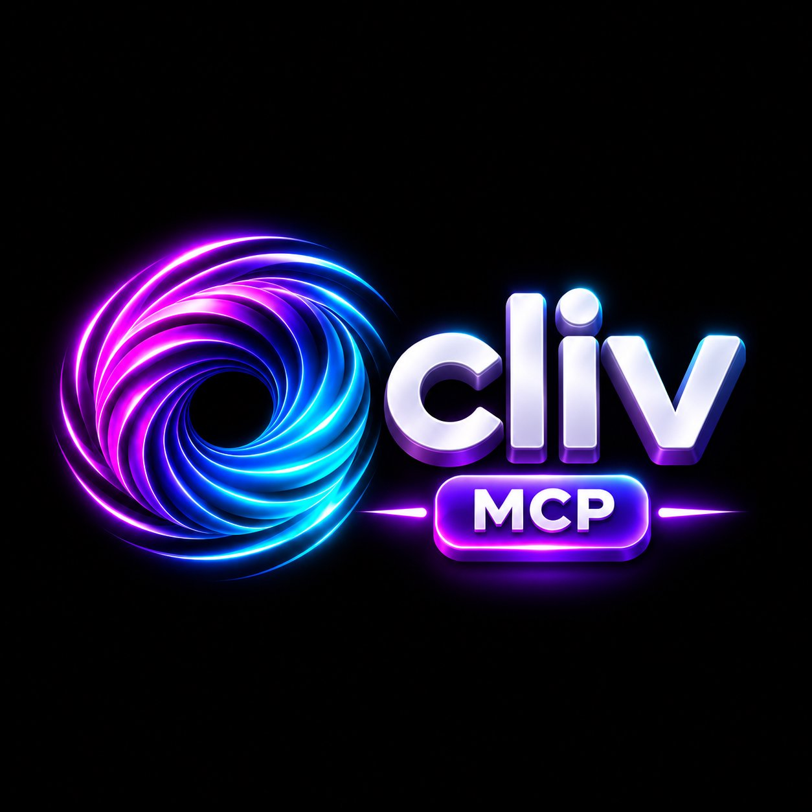
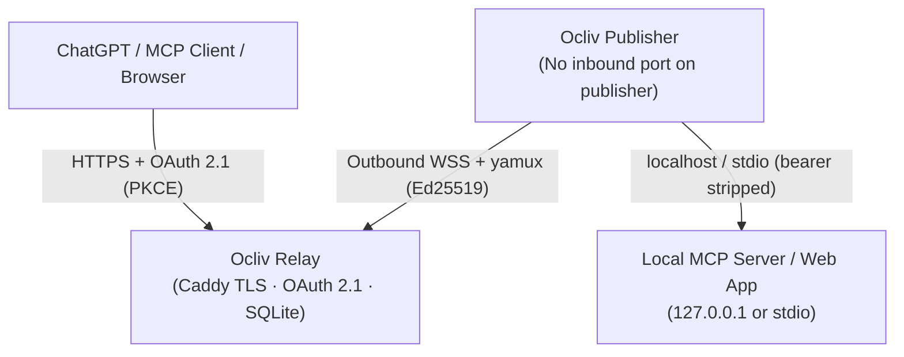

<p align="center">
  
</p>

# Ocliv

**Securely connect local MCP tools and web services to remote AI clients without exposing the machine running them.**


Ocliv is a self-hosted secure tunnel and MCP publishing platform that turns local services into persistent HTTPS endpoints without exposing inbound ports on the machine running them. It combines outbound-only tunnels, durable service identities, managed OAuth for MCP, and immediate revocation behind one CLI.

Run a local web app or MCP server, publish it with `ocliv host`, and get a stable HTTPS endpoint through infrastructure you control. Ocliv handles TLS, authenticated publisher tunnels, OAuth client authorization, service persistence, recovery, and revocation without requiring Cloudflare Tunnel, ngrok, Auth0, or another mandatory hosted control plane.

```sh
# 1. On the relay host — enroll a publisher machine over SSH (no code copying):
ocliv device add bamn@workstation --install

# 2. On the publisher machine — host a local MCP server with ChatGPT trusted:
ocliv host mcp 8765 --name tools --trust chatgpt

# 3. Inspect everything in one control panel:
ocliv status
```

```text
Service: tools
Local:   http://127.0.0.1:8765/mcp
Public:  https://relay.example.com/r/abc123/mcp

Persistence:     configured
Reboot recovery: verified
Connection:      connected
Route:           active
Authentication:  managed OAuth
Trusted clients: ChatGPT

Ready.
```

---

## Why Ocliv?

Most tunneling tools solve connectivity. Hosting Model Context Protocol (MCP) servers introduces a harder set of problems:

- The local machine should **not** accept inbound Internet connections.
- Public MCP endpoints need **OAuth 2.1** rather than anonymous exposure.
- A service must keep the **same public identity** across restarts, reboots, and reconnects.
- Authorization must be **revocable immediately**—per client, per trust policy, per route, or per device key.
- External OAuth bearer tokens should **never reach** the local MCP process.
- Self-hosting should **not** depend on another mandatory SaaS control plane or external IdP.

Ocliv treats all of those as one unified lifecycle rather than a pile of unrelated tools.

---

## What Makes Ocliv Different

- **Outbound-only publisher architecture:** Publishers dial out to the relay over Ed25519-authenticated `WSS` + `yamux`. Zero inbound listening sockets, zero router port forwarding on publisher machines.
- **Built-in OAuth 2.1 for MCP:** Dynamic Client Registration (RFC 7591), PKCE S256, route-bound resource indicators (RFC 8707), rotating refresh tokens, and route-scoped exact-redirect trust policies (`--trust chatgpt` or `--redirect-uri`).
- **External bearer stripping:** The relay validates and strips client OAuth bearer tokens at the edge before forwarding requests to your local MCP server.
- **Stable service & publication identity:** Named services (`--name`) preserve their public route URL across daemon restarts, reboots, and network drops, managed via user-level `systemd`.
- **Immediate, layered revocation:** Instantly revoke an OAuth client (`ocliv revoke client`), a route trust policy (`ocliv untrust`), a hosted service (`ocliv stop` / `ocliv remove`), or a publisher device key (`ocliv device revoke`).
- **Hardened state & supply chain:** Single-binary pure-Go relay backed by SQLite (WAL) with forward-only migrations, rollback-guarded backups/restores, and Ed25519-signed self-updates (`ocliv update`).

---

## How It Works

```text
  ChatGPT / MCP Client / Browser
                │
                │  HTTPS + OAuth 2.1 (PKCE S256)
                ▼
      ┌────────────────────┐
      │    Ocliv Relay     │  Caddy TLS · Ed25519 · OAuth 2.1 · SQLite
      └─────────▲──────────┘
                │
                │  Outbound-only authenticated WSS + yamux
                │  (No inbound port on publisher)
      ┌─────────┴──────────┐
      │  Ocliv Publisher   │  Zero inbound listening sockets
      └─────────┬──────────┘
                │
                │  127.0.0.1 / stdio
                ▼
       Local MCP / Web App
```



---

## Quick Start

### 1. Provision a relay host

Publisher machines never need open ports. Your relay host needs a public IP, DNS, and Caddy + `ocliv`:

```sh
# Diagnose host prerequisites without making changes:
ocliv setup --check

# Provision relay + Caddy TLS (wildcard default):
sudo ocliv setup --auto \
  --hostname example.net \
  --dns-provider cloudflare \
  --acme-email ops@example.net
```

### 2. Enroll a publisher device

Enroll any SSH-reachable machine directly from the relay host (no codes to copy):

```sh
# Remote machine over SSH (installs signed client if missing with --install):
ocliv device add user@machine --install

# Same-host unprivileged user (root never writes into the user's home):
sudo ocliv device add --local-user alice
```

If SSH is unavailable, fall back to interactive pairing:

```sh
# On the publisher machine:
ocliv pair https://relay.example.net

# On the relay host:
ocliv relay approve <CODE> --tenant default
```

### 3. Host a local MCP server or web app

```sh
# Persistent MCP server with ChatGPT trusted (managed OAuth):
ocliv host mcp 8765 --name tools --trust chatgpt

# Persistent stdio MCP server bridged to Streamable HTTP:
ocliv host --stdio --name tools --trust chatgpt -- ./my-mcp-server

# Persistent protected web app:
ocliv host http 3000 --name app

# Ephemeral protected web tunnel (wildcard edge):
ocliv 3000
```

---

## Everyday CLI

```sh
# Lifecycle & control panel
ocliv status                                       # Relay, device, services, trusted clients, and pending OAuth clients
ocliv stop tools                                   # Immediately disable public access, retain route identity
ocliv start tools                                  # Start a stopped hosted service
ocliv restart tools                                # Non-destructive restart/rebind
ocliv remove tools                                 # Permanently retire service & revoke route (interactive [y/N] or --yes)
ocliv doctor                                       # Diagnose key, relay, local service, and DNS/TLS
ocliv update [--check] [--yes]                     # Check for or install signed client updates from your relay

# Route-scoped OAuth trust & revocation
ocliv trust tools chatgpt                          # Trust ChatGPT's exact HTTPS callback on `tools`
ocliv trust tools --redirect-uri https://...       # Pin an exact HTTPS callback URI on `tools`
ocliv trust tools --client <CLIENT_ID>             # Approve a specific pending client directly
ocliv trust tools --list                           # List active trust policies on `tools`
ocliv untrust tools chatgpt                        # Revoke a trust policy
ocliv revoke client <CLIENT_ID> --service tools    # Revoke an OAuth client's access

# Device management (on relay host)
ocliv device list                                  # List enrolled devices/keys
ocliv device revoke <KEY_ID>                       # Revoke a publisher device key
```

Low-level administrative plumbing (`ocliv relay ...`, `ocliv authz ...`, `ocliv service ...`, `ocliv profile ...`) remains available for advanced automation; see [docs/OPERATOR.md](docs/OPERATOR.md).

---

## MCP & OAuth

Every managed MCP route (`ocliv-managed`) runs a route-scoped OAuth 2.1 Authorization Server at the relay:

- **Default-deny registration:** Unknown Dynamic Client Registrations land in `pending` state and cannot mint tokens until approved.
- **Route-scoped exact-redirect trust policies:** Running `ocliv host mcp 8765 --name tools --trust chatgpt` (or `ocliv trust tools chatgpt`) persists a durable trust policy scoped strictly to that `(tenant, route)` pinning ChatGPT's exact HTTPS callback (`https://chatgpt.com/connector_platform_oauth_redirect`). Any extra, wrong, non-HTTPS, cross-route, or cross-tenant redirect URI fails closed to pending approval.
- **Full PKCE + audit trail:** Auto-approved registrations still enforce PKCE S256, route-bound RFC 8707 resource indicators, RFC 9207 `iss` parameters on authorization responses, and emit a distinct `authz-auto-approve` audit event. Revoking a trust policy (`ocliv untrust`) immediately stops **future** automatic approvals for new registrations; previously approved clients retain access until explicitly revoked with `ocliv revoke client <CLIENT_ID>`.

See [docs/MCP-HOSTING.md](docs/MCP-HOSTING.md) for stdio bridging, upstream OAuth, and client integration details.

---

## Security Model

- **Default-deny exposure:** Tunnels are private by default; `--public` requires explicit tenant policy opt-in.
- **Fail-closed authority & crypto boundaries:** Private keys and env files are loaded via single-FD `O_NOFOLLOW` with regular-file, `0600`, and owner checks. Body-bearing management mutations require negotiated `mgmt_body_sig_v2`.
- **Forward-only state & rollback-guarded restore:** Schema migrations are strictly forward-only. Offline backups (`VACUUM INTO`) verify checksums and refuse restores that would resurrect revoked keys, leases, publications, OAuth grants, or trust policies unless `--reset-authority` is explicitly passed.
- **Signed release trust root:** Release manifests are verified against an embedded Ed25519 trust root with SHA-256 artifact digests and anti-rollback sequence numbers.

See [docs/SECURITY.md](docs/SECURITY.md) for the complete threat model and invariants.

---

## Deployment

Two production edge modes are supported:

- **`wildcard` (default):** Wildcard DNS (`*.t.<domain>`) + single DNS-01 wildcard certificate. Supports both HTTP/WS subdomain tunnels and MCP path routes.
- **`single-host`:** Single public hostname with standard ACME TLS (no wildcard DNS required). Serves agent control and path-based MCP routes (`/r/<route-id>/mcp`).

See [docs/SETUP.md](docs/SETUP.md), [docs/HOME-HOST.md](docs/HOME-HOST.md), [docs/VPS.md](docs/VPS.md), and [docs/OPERATOR.md](docs/OPERATOR.md) for complete deployment guides.

---

## Project Status

**Active development.** Core relay, publisher, managed OAuth, route-scoped trust policies, persistent hosting, revocation, backup/restore, and signed release infrastructure are implemented and tested. Production promotion, live staging qualification, and external interoperability gates are tracked independently by exact commit SHA in [docs/qualification/CURRENT.md](docs/qualification/CURRENT.md).

---

## Development

Requires Go 1.26+ (single Go module, `CGO_ENABLED=0`).

```sh
# Build binary:
go build -trimpath -o dist/ocliv ./cmd/ocliv

# Repository hygiene, formatting, vet, and test suites:
./scripts/check-repo-hygiene.sh
go vet ./...
go test ./... -count=1 -timeout=420s
```

### Documentation & Skills

| Resource | Purpose |
|---|---|
| [docs/SETUP.md](docs/SETUP.md) | Relay installation, edge modes, and TLS setup |
| [docs/OPERATOR.md](docs/OPERATOR.md) | Day-2 operations, backups, restores, and key lifecycle |
| [docs/MCP-HOSTING.md](docs/MCP-HOSTING.md) | Publishing local HTTP and stdio MCP servers |
| [docs/SECURITY.md](docs/SECURITY.md) | Threat model, authority boundaries, and crypto invariants |
| [docs/PROTOCOL.md](docs/PROTOCOL.md) | Wire protocol and capability negotiation |
| [docs/qualification/CURRENT.md](docs/qualification/CURRENT.md) | Current verification ledger by exact commit SHA |
| [skills/ocliv-setup-and-ops/SKILL.md](skills/ocliv-setup-and-ops/SKILL.md) | Portable AI agent skill for setting up and troubleshooting Ocliv |

### Repository Layout

- `cmd/ocliv/` — Unified CLI and relay entrypoint
- `internal/` — Core Go packages (`access`, `agent`, `authz`, `cli`, `config`, `control`, `doctor`, `identity`, `installer`, `lease`, `limits`, `mcp`, `protocol`, `proxy`, `relay`, `setup`, `store`, `transport`)
- `packaging/` — Systemd units, Caddyfiles, and signed client bootstrap installer
- `scripts/` — Repository hygiene, reproducible release builder, and qualification harnesses
- `skills/` — Portable AI agent operator skills
- `tests/` — Integration suites and fixtures
- `docs/` — Operator, setup, security, protocol, and qualification documentation

---

## Origin

Ocliv was originally developed as a Meta hackathon project exploring secure infrastructure for connecting local AI tools and MCP services to remote AI clients. It has since evolved into a broader self-hosted publishing and authorization platform.
